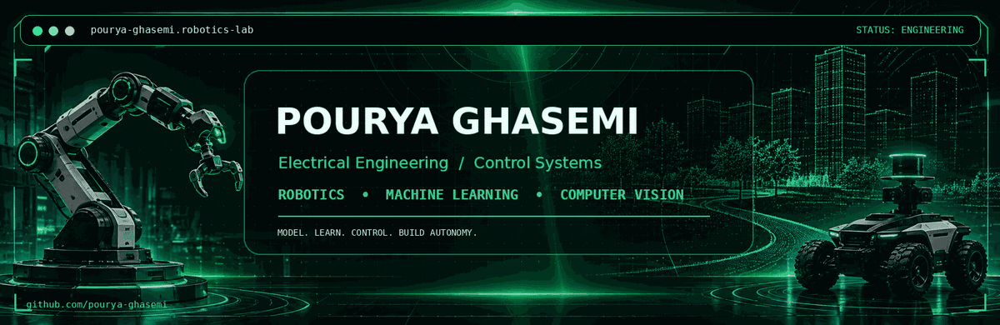

<div align="center">



# Pourya Ghasemi

### Electrical Engineering (Control Systems) · Intelligent Robotics

[](https://www.linkedin.com/in/pourya-ghasemi03/)
[](mailto:pourya.ghasemi03@gmail.com)
[](https://github.com/pourya-ghasemi)

**Think in systems · Learn through implementation · Validate with evidence**

</div>

---

## 👨‍💻 About Me

I'm an Electrical Engineering student specializing in **Control Systems** at the **University of Zanjan, Iran**, expected to graduate in 2027. My academic interests focus on the intersection of **robotics, machine learning, computer vision, and intelligent control**.

My current research centers on **LiDAR-based mobile robot navigation**, where I am exploring how neural-network-based imitation learning can use Artificial Potential Field (APF)-generated guidance. I work with **Python, ROS 2, and Gazebo** as part of this undergraduate thesis.

Beyond robotics, I enjoy engineering problems that connect mathematical ideas, software, and physical systems, including adaptive signal processing and digital hardware integration.

## 🧭 Research & Technical Focus

<table>
  <tr>
    <td width="25%" valign="top">
      <h3>🤖 Robotics & Autonomous Systems</h3>
      <ul>
        <li>Mobile robot navigation</li>
        <li>Motion planning</li>
        <li>Multi-robot coordination</li>
      </ul>
    </td>
    <td width="25%" valign="top">
      <h3>🧠 Machine Learning</h3>
      <ul>
        <li>Neural-network methods</li>
        <li>Imitation learning</li>
        <li>Learning-based systems</li>
      </ul>
    </td>
    <td width="25%" valign="top">
      <h3>👁️ Image Processing & Computer Vision</h3>
      <ul>
        <li>Visual perception</li>
        <li>Image analysis</li>
        <li>Vision for robotics</li>
      </ul>
    </td>
    <td width="25%" valign="top">
      <h3>🎛️ Intelligent Control</h3>
      <ul>
        <li>Adaptive control</li>
        <li>Feedback systems</li>
        <li>Model predictive control</li>
      </ul>
    </td>
  </tr>
</table>

## 🚀 Selected Projects

<table>
  <tr>
    <td width="33%" valign="top">
      <h3>🛰️ LiDAR-Based Mobile Robot Navigation</h3>
      <p><strong>🟡 Undergraduate Thesis · In Progress</strong></p>
      <p>APF-guided imitation learning for mobile robot navigation, with LiDAR and goal/state information, neural-network behavior cloning, and subgoal-based recovery.</p>
      <p><sub>Python · ROS 2 · Gazebo · Neural Networks</sub></p>
    </td>
    <td width="33%" valign="top">
      <h3>📈 Adaptive FIR Filter with ADALINE</h3>
      <p><strong>✅ Course Project · Completed · 2025</strong></p>
      <p>Implementation of an adaptive FIR predictor using ADALINE and an online LMS-style weight update, with a noisy sinusoidal signal and documented results.</p>
      <p><sub>Python · NumPy · Adaptive Signal Processing</sub></p>
    </td>
    <td width="33%" valign="top">
      <h3>🔌 ARM–FPGA Webcam-to-VGA System</h3>
      <p><strong>✅ Course Project · Completed · 2026</strong></p>
      <p>A digital systems project integrating an ARM board, webcam input, FPGA logic, and VGA display output.</p>
      <p><sub>ARM · FPGA · Verilog HDL · Quartus II</sub></p>
    </td>
  </tr>
</table>

> **Project integrity:** statuses reflect the actual development stage. Repository links and implementation details will be added when each project is ready for public release.

## 🔬 Ongoing & Future Research Directions

| Direction | Stage | Focus |
|:---|:---:|:---|
| **Neural-Network-Assisted Adaptive Robot Control with MPC** | 🟡 Early stage | Exploring the integration of neural-network methods and model predictive control for robot control. |
| **Multi-Robot Cooperative Exploration & Task Allocation** | 🔵 Planned extension | A proposed extension of my single-robot navigation work toward cooperative exploration and task allocation. |

## 🛠️ Engineering Toolkit

| **Programming** | **Machine Learning & Data** | **Robotics & Simulation** | **Engineering Tools** |
|:---|:---|:---|:---|
| Python · C · C++ (familiar) · Verilog HDL (familiar) | PyTorch · Scikit-learn · NumPy · Pandas | ROS 2 · Gazebo · RViz2 | MATLAB · Simulink · STM32CubeIDE · Quartus II · Altium Designer · SolidWorks |

<div align="center">


</div>

## 🎓 Academic Journey & Activities

| Experience | Details |
|:---|:---|
| 🎓 **B.Sc. Electrical Engineering (Control Systems)** | University of Zanjan, Iran · 2022–2027 (expected) |
| 🧪 **Teaching Assistant** | Linear Control Systems Laboratory · 2026 |
| ⚙️ **Laboratory Support** | Assisted with Industrial Control Laboratory setup · 2025–2026 |
| 🤖 **Robotics Association Leadership** | Led the University of Zanjan Robotics Association · 2023–2025 |

## 🏅 Selected Highlights

- 🥈 **Second Place, Kharazmi Competitions (Provincial Level), 2016** — built a tracked rescue robot as a middle-school student.
- 🏅 **Academic Progress Award, University of Zanjan, 2026.**
- 🧑‍🏫 Organized robotics workshops and two editions of a path-finding robot competition; also served as a competition judge.

## ⚙️ Engineering Approach

```text
DEFINE THE PROBLEM
        ↓
MODEL THE SYSTEM
        ↓
IMPLEMENT THE IDEA
        ↓
MEASURE & DEBUG
        ↓
VERIFY THE RESULT
```

I value clear assumptions, sound engineering fundamentals, reproducible experiments, and honest reporting of limitations. A result matters when its method can be understood, tested, and independently checked.

## 📬 Connect

I'm interested in graduate study and research opportunities related to **robotics, autonomous systems, machine learning, computer vision, and intelligent control**.

- 💼 **LinkedIn:** [pourya-ghasemi03](https://www.linkedin.com/in/pourya-ghasemi03/)
- ✉️ **Email:** [pourya.ghasemi03@gmail.com](mailto:pourya.ghasemi03@gmail.com)
- 🧑‍💻 **GitHub:** [pourya-ghasemi](https://github.com/pourya-ghasemi)

<div align="center">

### `MODEL. LEARN. CONTROL. BUILD AUTONOMY.`

<sub>Thanks for visiting · Always exploring the space between control, learning, and intelligent machines.</sub>

</div>

