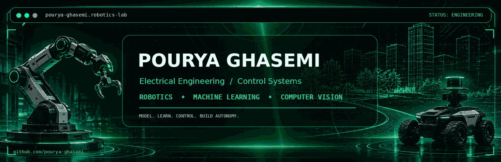

### Electrical Engineering · Control Systems · Intelligent Robotics

**MODEL. LEARN. CONTROL. BUILD AUTONOMY.**

---

## 👨‍💻 About Me

I'm an Electrical Engineering student with a background in **Control Systems** at the **University of Zanjan**. My interests lie at the intersection of **robotics, machine learning, computer vision, and intelligent control**, especially in systems that perceive their environment, make decisions, and act reliably.

My current research explores **LiDAR-based mobile robot navigation** using neural-network-based imitation learning guided by an **Artificial Potential Field (APF)**. Alongside this work, I have developed projects in adaptive signal processing and digital hardware integration, building an engineering perspective that connects mathematical models, software, and system-level implementation.

Robotics has been a long-standing interest of mine, shaped by hands-on building and later by leading the **University of Zanjan Robotics Association**. I enjoy approaching complex engineering problems methodically: understanding the system, testing ideas, and improving solutions through measurable results.

## 🧭 Research & Technical Focus

<table align="center" width="100%">
  <tr>
    <td width="50%" valign="top">
      <h3>🤖 Robotics & Autonomous Systems</h3>
      <ul>
        <li>LiDAR-based mobile robot navigation</li>
        <li>Motion planning and obstacle avoidance</li>
        <li>Autonomous mobile robots</li>
        <li>Cooperative multi-robot exploration</li>
      </ul>
    </td>
    <td width="50%" valign="top">
      <h3>🧠 Machine Learning</h3>
      <ul>
        <li>Neural-network models</li>
        <li>Imitation learning and behavior cloning</li>
        <li>Supervised learning and model evaluation</li>
        <li>Learning-based decision-making</li>
      </ul>
    </td>
  </tr>
  <tr>
    <td width="50%" valign="top">
      <h3>👁️ Image Processing & Computer Vision</h3>
      <ul>
        <li>Image enhancement and filtering</li>
        <li>Feature extraction and representation</li>
        <li>Object detection and visual recognition</li>
        <li>Visual perception for robotics</li>
      </ul>
    </td>
    <td width="50%" valign="top">
      <h3>🎛️ Intelligent Control</h3>
      <ul>
        <li>Model Predictive Control (MPC)</li>
        <li>Adaptive and self-tuning control</li>
        <li>Learning-based control</li>
        <li>Feedback systems and stability analysis</li>
      </ul>
    </td>
  </tr>
</table>

## 🚀 Selected Projects

<table>
  <tr>
    <td width="33%" valign="top">
      <h3>🛰️ LiDAR-Based Mobile Robot Navigation</h3>
      
<strong>🟡 Undergraduate Thesis · In Progress</strong>

      
APF-guided imitation learning for mobile robot navigation, combining LiDAR and goal/state information, neural-network behavior cloning, and subgoal-based recovery.

      
Python · ROS 2 · Gazebo · Neural Networks

    </td>
    <td width="33%" valign="top">
      <h3>📈 Adaptive FIR Filter with ADALINE</h3>
      
<strong>✅ Course Project · Completed · 2025</strong>

      
Implementation of an adaptive FIR predictor using ADALINE and an online LMS-style weight update, evaluated with a noisy sinusoidal signal.

      
Python · NumPy · Adaptive Signal Processing

    </td>
    <td width="33%" valign="top">
      <h3>🔌 ARM–FPGA Webcam-to-VGA System</h3>
      
<strong>✅ Course Project · Completed · 2026</strong>

      
A digital systems project integrating an ARM board, webcam input, FPGA logic, and VGA display output.

      
ARM · FPGA · Verilog HDL · Quartus II

    </td>
  </tr>
</table>

> **Project integrity:** project statuses reflect their actual development stage. Source-code links and implementation details will be added as each repository is prepared for public release.

## 🔬 Ongoing & Future Research Directions

| Direction | Stage | Focus |
|:---|:---:|:---|
| **Neural-Network-Assisted Adaptive Robot Control with MPC** | 🟡 Early stage | Exploring how neural-network methods can complement model predictive control in robot control. |
| **Multi-Robot Cooperative Exploration & Task Allocation** | 🔵 Planned extension | A future extension of my single-robot navigation work toward cooperative exploration and task allocation. |

## 🛠️ Engineering Toolkit

| **Programming** | **Machine Learning & Data** | **Robotics & Simulation** | **Engineering Tools** |
|:---|:---|:---|:---|
| Python · C · C++ (familiar) · Verilog HDL (familiar) | PyTorch · Scikit-learn · NumPy · Pandas | ROS 2 · Gazebo · RViz2 | MATLAB · Simulink · STM32CubeIDE · Quartus II · Altium Designer · SolidWorks |

## 🎓 Academic Journey & Activities

| Experience | Details |
|:---|:---|
| 🎓 **B.Sc. in Electrical Engineering (Control Systems)** | University of Zanjan, Iran |
| 🤖 **Robotics Association Leadership** | Led the University of Zanjan Robotics Association · 2023–2025 |

## 🧠 How I Think

I’m drawn to problems where theory meets reality. I turn complex ideas into models, experiments, and working systems, refining each step through evidence rather than assumptions. **Curiosity sets the direction; rigorous execution earns the result.**

## 📬 Connect

I'm interested in graduate study and research opportunities related to **robotics, autonomous systems, machine learning, computer vision, and intelligent control**.

- 💼 **LinkedIn:** [pourya-ghasemi03](https://www.linkedin.com/in/pourya-ghasemi03/)
- ✉️ **Email:** [pourya.ghasemi03@gmail.com](mailto:pourya.ghasemi03@gmail.com)
- 🧑‍💻 **GitHub:** [pourya-ghasemi](https://github.com/pourya-ghasemi)

### `MODEL. LEARN. CONTROL. BUILD AUTONOMY.`

Pourya Ghasemi · Robotics, Machine Learning & Intelligent Control

